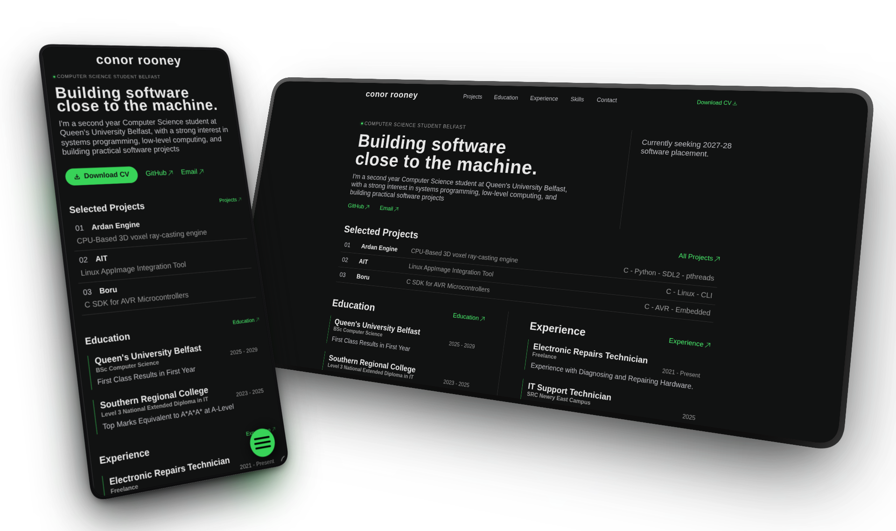

# conor-rooney.com
My personal porfolio website. Used as a place to store information on my projects, education, and experience.



## Built with

- PHP for page composition and reusable components
- HTML and CSS for the site layout and styling
- A small amount of JavaScript for the mobile navigation and notifications

The project has no package manager or third-party runtime dependencies. It is organized as a lightweight server-rendered site, with the web server serving files from `public/`.

## Run locally

From the repository root, start PHP’s built-in web server with `public/` as its document root:

```sh
php -S localhost:8000 -t public
```

Then open [http://localhost:8000](http://localhost:8000). PHP must be installed and available on your `PATH`.

## Project structure

```text
components/       Reusable PHP interface components
helpers/          CSS and JavaScript asset registrars
sections/         PHP templates for the home page sections
public/           Web root: entry pages and static assets
  assets/css/     Global, section, and component stylesheets
  assets/js/      Mobile navigation and notification scripts
  assets/icons/   SVG interface and social icons
  assets/favicons/ Site favicons
```

I’ve built the home page in `public/index.php` from shared components and sections for the introduction, projects, education, and experience. Components and sections register the assets they need through the helpers, and the page outputs those assets in its document head.

## Current scope

The home page is the main implemented page. The projects, education, skills, contact, and CV entry pages currently redirect to `coming_soon.php`; their full content and CV download are not yet implemented.

## License

This project is released under the [MIT License](./LICENSE).
